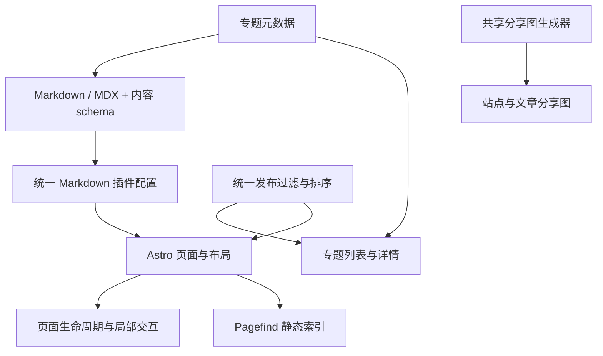

# 站点架构与维护约定

更新日期：2026-11-09。面向维护这个 Astro 静态研究博客的开发者。

## 架构选择

保留 Astro 静态输出、Markdown / MDX 内容、局部客户端脚本和语义化 CSS。成熟的渲染与交互能力使用已有库，仓库只保留内容组织、页面布局和少量适配代码。当前内容规模适合直接的数据模块和函数，无需引入状态管理、通用组件注册系统或第二套内容引擎。

## 功能入口

| 职责               | 唯一入口或边界                                              | 扩展方式                                             |
| ------------------ | ----------------------------------------------------------- | ---------------------------------------------------- |
| 站点信息、功能开关 | `astro-paper.config.ts`；`src/config.ts` 解析默认值         | 修改用户配置，避免在页面另建副本                     |
| 内容字段校验       | `src/content.config.ts`                                     | 增加 schema 字段，再消费经过校验的数据               |
| 专题信息           | `src/data/collections.ts`                                   | 增加一项；schema、目录和详情共用该定义               |
| 发布过滤与排序     | `src/utils/getPublishedPosts.ts`、`selectPublishedPosts.ts` | 列表、计数和路由复用相同规则                         |
| Markdown / MDX     | `src/markdown.config.mjs`                                   | 修改共享插件配置；生产构建与回归测试共用             |
| 代码块             | `ec.config.mjs`                                             | Expressive Code 管理高亮、复制、行号和换行按钮       |
| 主题和配色         | `src/styles/theme.css`、`global.css`、`typography.css`      | 修改语义变量与正文样式，代码框跟随主题               |
| 页面内交互         | `src/scripts/onPageLoad.ts`                                 | 初始化接收 `AbortSignal`；页面替换时清理监听和观察器 |
| 图片与阅读进度     | `src/scripts/article.ts`                                    | PhotoSwipe 管理图片交互；站点维护图片数据和进度      |
| Mermaid 图         | `src/utils/rehypeMermaid.js`、`src/scripts/mermaid.ts`      | 构建时保存源文，浏览器按需加载并串行渲染             |
| 分享图             | `src/utils/createOgImage.ts`                                | 站点和文章路由仅传入内容，共用模板和字体读取         |
| 界面文案           | `src/i18n/lang/zh-Hans.ts`                                  | 中文界面使用中文词典，英语词典作为回退               |

内容只有 `posts` 一个集合：文章列表按最近更新时间浏览，专题通过 `collection` 归组，不另设笔记内容系统。`getPublishedPosts()` 统一读取内容并调用可独立测试的发布策略；首页、列表、专题计数、详情、归档、RSS 与分享图都复用它。生产环境按文章或站点时区的日历日期发布，开发环境可预览未来文章，草稿始终隐藏。归档按发表年月分组；其他列表按更新时间倒序。

日期解析、时区校验和 Day.js 插件初始化归 `src/utils/datetime.ts`，发布策略、日期展示与归档共用。归档直接使用 Node.js 原生 `Map.groupBy`；只有出现额外业务规则时才考虑自己的分组工具。专题数据只在 `src/data/collections.ts` 维护，首页条数读取用户配置。专题字段 `collection` 是唯一的文章归组维度；未使用的 `kind`、标签、精选和论文计数字段不作为站点契约。

`Layout.astro` 统一装配文档外壳、Header 和 Footer，页面只提供主体内容；`PostLayout.astro` 在此基础上增加文章元数据。分页列表通过 `footerNoMarginTop` 保留多页时的页脚间距。首页与专题目录共用 `CollectionCard.astro`，标题级别由所在页面决定，文章计数可选。

导航文案归语言词典，Header 用同一列表渲染常规入口。词典满足同一完整类型，未知语言回退到英语，默认使用站点语言。历史地址统一归 `astro.config.ts` 的 redirects；`/notes` 与旧介绍地址转到文章列表，其余旧文章地址保留目标路径。GitHub Pages 输出的是静态跳转页，不能当作 HTTP 308 服务端重定向。

`theme.ts` 的首次主题应用与切页处理保留独立入口，因为主题需要尽早设置，避免页面出现错误主题。页面内的菜单、目录、返回按钮、图片和进度条使用 `onPageLoad`。异步加载完成后检查页面是否仍然有效，避免向已移除的页面写入内容。

## 已有库与自有代码的边界

数学公式由 `remark-math` 解析、`rehype-mathjax` 在构建时输出 SVG。`tex.tags: "all"` 负责行间编号，MathJax 负责 `aligned`、`\tag`、`\notag` 和局部颜色。公式默认颜色由 CSS 独立变量管理，行内 SVG 保持行内布局。

代码块统一交给 Expressive Code，行号使用官方插件，手动换行使用社区插件。自然语言代码块默认换行并隐藏行号，代码默认显示行号并横向滚动；读者可逐块切换换行。Frames 0.44.3 的复制事件选择器会匹配同工具栏中的换行按钮；`ec.config.mjs` 仅将它限定到带 `data-code` 的复制按钮，保留原有复制逻辑。回归测试执行实际初始化脚本，确认只绑定复制按钮。这个有版本依据的兼容修正应在上游解决后移除，升级时需验证复制、换行按钮和控制台错误。

图片查看使用 PhotoSwipe 的缩放、触摸、键盘和焦点处理能力[^photoswipe]。文章脚本只组织图片尺寸、中文按钮文案、触发事件和销毁时机。打开一张图片只等待该图片解码，避免被尚未进入视口的懒加载图片阻塞。

标题链接使用 `rehype-autolink-headings`[^headings]，提示框使用 `rehype-callouts`，搜索使用 Pagefind。目录只消费 Astro 提供的 headings，不再自行解析文章生成第二份目录。

仓库保留两个小型 Rehype 适配：表格增加可聚焦的横向滚动容器；Mermaid 在代码高亮前保存源文并输出无 JavaScript 时的文字回退。这些适配对应站点的实际结构需求，未引入额外插件框架。目录滚动定位和阅读进度继续使用浏览器 API。

历史整理与验证数据见[架构审查](research/2026-11-09-架构审查.md)。当前阅读写法见[阅读指南](reading.md)，维护检查见[开发指南](development.md)。

## 保留的限制

Mermaid 的部分按需加载分块超过 Vite 的 500 kB 提示阈值。普通页面不会因此加载完整渲染器；若图表规模增长，再按实际使用的图形类型评估裁剪。

Pagefind 对静态跳转页面提示缺少外层 HTML；文章索引正常生成。重定向页面无需纳入全文搜索。

分享图字体沿用 Google 字体提供器，首次构建需要访问字体服务，后续可利用 Astro 缓存。

当前机器未安装 Docker，容器配置完成静态核对，尚未运行容器构建。GitHub CI 的结果仍以远端执行为准。

依赖审计使用 `npm audit` 核对当前锁文件；历史检查数值保留在对应报告，不能作为当前依赖状态。

## 日常修改约定

1. 新功能先检查现有库的配置和插件，确认其无法满足需求后再增加适配代码。
2. 数据先进入 schema 或共享数据模块，页面只负责消费和展示。
3. 优先在构建时完成渲染，客户端库按内容需要加载。
4. 页面事件归属页面生命周期；全局事件必须说明跨页面存在的原因。
5. 仅在两个真实调用方出现相同规则时提取共享函数；保留用途明确的小函数，避免提前搭建扩展框架。
6. 调整渲染器时同步更新演示文章和行为测试；移除旧实现时一并删除依赖、样式、声明和文案。

### 参考文献

[^photoswipe]: PhotoSwipe. Getting started. 官方文档. [PhotoSwipe](https://photoswipe.com/getting-started/)。

[^headings]: rehypejs. rehype-autolink-headings. 官方仓库. [rehype-autolink-headings](https://github.com/rehypejs/rehype-autolink-headings)。
