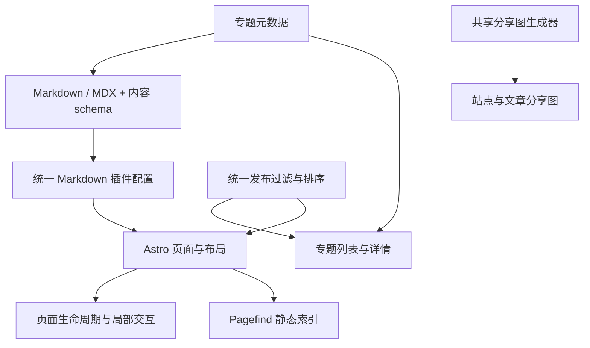

# 站点架构与维护约定

更新日期：2026-11-09。面向维护这个 Astro 静态研究博客的开发者。

## 架构选择

保留 Astro 静态输出、Markdown / MDX 内容、局部客户端脚本和语义化 CSS。成熟的渲染与交互能力使用已有库，仓库只保留内容组织、页面布局和少量适配代码。当前内容规模适合直接的数据模块和函数，无需引入状态管理、通用组件注册系统或第二套内容引擎。

## 功能入口

| 职责               | 唯一入口或边界                                         | 扩展方式                                             |
| ------------------ | ------------------------------------------------------ | ---------------------------------------------------- |
| 站点信息、功能开关 | `astro-paper.config.ts`；`src/config.ts` 解析默认值    | 修改用户配置，避免在页面另建副本                     |
| 内容字段校验       | `src/content.config.ts`                                | 增加 schema 字段，再消费经过校验的数据               |
| 专题信息           | `src/data/collections.ts`                              | 增加一项；schema、目录和详情共用该定义               |
| 发布过滤与排序     | `src/utils/postFilter.ts`、`getSortedPosts.ts`         | 列表、计数和路由复用相同规则                         |
| Markdown / MDX     | `src/markdown.config.mjs`                              | 修改共享插件配置；生产构建与回归测试共用             |
| 代码块             | `ec.config.mjs`                                        | Expressive Code 管理高亮、复制、行号和换行按钮       |
| 主题和配色         | `src/styles/global.css`、`typography.css`              | 修改语义变量与正文样式，代码框跟随主题               |
| 页面内交互         | `src/scripts/onPageLoad.ts`                            | 初始化接收 `AbortSignal`；页面替换时清理监听和观察器 |
| 图片与阅读进度     | `src/scripts/article.ts`                               | PhotoSwipe 管理图片交互；站点维护图片数据和进度      |
| Mermaid 图         | `src/utils/rehypeMermaid.js`、`src/scripts/mermaid.ts` | 构建时保存源文，浏览器按需加载并串行渲染             |
| 分享图             | `src/utils/createOgImage.ts`                           | 站点和文章路由仅传入内容，共用模板和字体读取         |
| 界面文案           | `src/i18n/lang/zh-Hans.ts`                             | 中文界面使用中文词典，英语词典作为回退               |

`theme.ts` 的首次主题应用与切页处理保留独立入口，因为主题需要尽早设置，避免页面出现错误主题。页面内的菜单、目录、返回按钮、图片和进度条使用 `onPageLoad`。异步加载完成后检查页面是否仍然有效，避免向已移除的页面写入内容。

## 已有库与自有代码的边界

数学公式由 `remark-math` 解析、`rehype-mathjax` 在构建时输出 SVG。`tex.tags: "all"` 负责行间编号，MathJax 负责 `aligned`、`\tag`、`\notag` 和局部颜色。公式默认颜色由 CSS 独立变量管理，行内 SVG 保持行内布局。

代码块统一交给 Expressive Code，行号使用官方插件，手动换行使用社区插件。自然语言代码块默认换行并隐藏行号，代码默认显示行号并横向滚动；读者可逐块切换换行。Frames 0.44.3 的复制事件选择器会匹配同工具栏中的换行按钮；`ec.config.mjs` 仅将它限定到带 `data-code` 的复制按钮，保留原有复制逻辑。回归测试执行实际初始化脚本，确认只绑定复制按钮。这个有版本依据的兼容修正应在上游解决后移除，升级时需验证复制、换行按钮和控制台错误。

图片查看使用 PhotoSwipe 的缩放、触摸、键盘和焦点处理能力[^photoswipe]。文章脚本只组织图片尺寸、中文按钮文案、触发事件和销毁时机。打开一张图片只等待该图片解码，避免被尚未进入视口的懒加载图片阻塞。

标题链接使用 `rehype-autolink-headings`[^headings]，提示框使用 `rehype-callouts`，搜索使用 Pagefind。目录只消费 Astro 提供的 headings，不再自行解析文章生成第二份目录。

仓库保留两个小型 Rehype 适配：表格增加可聚焦的横向滚动容器；Mermaid 在代码高亮前保存源文并输出无 JavaScript 时的文字回退。这些适配对应站点的实际结构需求，未引入额外插件框架。目录滚动定位和阅读进度继续使用浏览器 API。

## 2026-11-09 审查与整理

| 原有问题                                                    | 完成的调整                                                                                                   |
| ----------------------------------------------------------- | ------------------------------------------------------------------------------------------------------------ |
| 文章路由混入大量缩放、拖动、键盘和页面事件处理              | 图片交互交给 PhotoSwipe，客户端脚本移出页面，统一清理生命周期                                                |
| 代码块迁移后残留旧 Shiki CSS、文件名 transformer 和依赖     | 删除旧实现，所有代码块配置集中到 Expressive Code                                                             |
| 旧行内目录插件和新目录并存，旧插件依赖未使用                | 删除旧目录兼容实现与 `remark-toc`、`remark-collapse`                                                         |
| 表格组件和 Markdown 表格包装重复                            | 删除未使用组件，保留构建时的统一包装                                                                         |
| 专题元数据维护三份，计数未复用定时发布规则                  | schema、目录和详情共用专题注册表；计数使用统一发布过滤                                                       |
| 站点和文章分享图复制字体读取与模板                          | 共用生成函数和模板；文章只传标题、作者等差异；修正边框溢出和中文缺字                                         |
| 所有页面引用不存在的 ICO，404 页 canonical 指向未生成的路径 | 仅引用现有 SVG 图标，404 canonical 指向实际输出文件                                                          |
| 页面同时输出 website 和 article 两个 `og:type`              | 布局接收明确的类型参数，只输出一项                                                                           |
| 页面预加载仅供分享图构建使用的字体                          | 移除网页中的额外字体预加载，分享图通过 Astro 字体提供器加载 Noto Sans SC，并按站点信息与文章内容裁剪中文字形 |
| 默认中文站点缺少中文词典                                    | 补齐中文界面文案，保留既有语言回退机制                                                                       |
| 系统主题变化覆盖读者手动选择                                | 已保存的主题优先，保留按钮可访问名称                                                                         |
| 搜索可能重复初始化，清空按钮错误读取输入值                  | 增加初始化状态和异步导航检查，分别处理输入与清空事件                                                         |
| npm 与 pnpm 配置并存，锁文件和 CI 不一致                    | 开发、CI、Docker 统一 npm 和 `package-lock.json`                                                             |
| Docker 忽略规则排除了 `.astro` 源文件                       | 修正规则，容器使用 Node.js 24 与 `npm ci`                                                                    |
| 测试引用已删除的旧站点文件，未加入执行链                    | 替换为共享渲染配置的回归测试，并接入 CI                                                                      |
| 未使用工具函数、声明和过时文案                              | 删除无调用代码，演示文章改为说明实际功能                                                                     |

文章路由由 694 行缩减到约 200 行，交互职责移到独立脚本。文件拆分本身不代表复杂度下降；主要减少来自删除旧兼容层、用图片库替换手写交互、合并分享图模板和消除多份配置。

## 检查方法与结果

使用同一组 jscpd 5.4.3 参数对整理前的 `ec0b530` 与整理后的 `src/` 扫描：`--min-lines 8 --min-tokens 65 --ignore '**/assets/**'`。整理前为 3 组重复片段、100 行重复；整理后为 0 组。该结果只覆盖达到阈值的文字重复，语义重复还需结合入口、职责和调用关系审查。

Knip 6.44.2 使用仓库内的 `knip.json` 扫描未使用文件、导出和依赖。Astro、MDX、CSS 显式加入扫描范围；动态加载的语言词典和 Node 测试列为入口。结果无未使用项。静态扫描不能替代页面交互和动态加载检查。

回归测试直接复用生产 Markdown 配置和 Expressive Code 配置，覆盖自动编号、手动编号、取消编号、跨文章编号重置、局部公式颜色、标题链接、表格包装、Mermaid 源文、提示框、代码行号、换行按钮和复制事件绑定。ESLint、Prettier、Astro 类型检查和完整静态构建共同验证配置与页面。

四项 Node 测试通过；完整构建的 77 个文件类型检查为 0 错误、0 警告、0 提示。

浏览器检查覆盖桌面与 390px 手机视口、行内公式、代码换行、主题切换、Mermaid、图片切换与焦点恢复、客户端往返导航、搜索与清空、手机菜单和目录。生成的 16 个 HTML 页面经过本地目标与片段链接检查，297 个本地引用无失效目标。

以上浏览器检查已通过，控制台无未捕获错误，手机视口和文档宽度均为 390px；浏览器检查不属于持续集成测试。

## 保留的限制

Mermaid 的部分按需加载分块超过 Vite 的 500 kB 提示阈值。普通页面不会因此加载完整渲染器；若图表规模增长，再按实际使用的图形类型评估裁剪。

Pagefind 对三个旧路径重定向页面提示缺少外层 HTML；文章索引正常生成。重定向页面无需纳入全文搜索。

分享图字体沿用 Google 字体提供器，首次构建需要访问字体服务，后续可利用 Astro 缓存。

当前机器未安装 Docker，容器配置完成静态核对，尚未运行容器构建。GitHub CI 的结果仍以远端执行为准。

依赖审计仍有 14 项提示（3 项低危、11 项中危，无高危或严重项），涉及构建工具和间接依赖。未用自动强制降级处理，后续应按上游兼容性分别更新并复测。

## 日常修改约定

1. 新功能先检查现有库的配置和插件，确认其无法满足需求后再增加适配代码。
2. 数据先进入 schema 或共享数据模块，页面只负责消费和展示。
3. 优先在构建时完成渲染，客户端库按内容需要加载。
4. 页面事件归属页面生命周期；全局事件必须说明跨页面存在的原因。
5. 仅在两个真实调用方出现相同规则时提取共享函数；保留用途明确的小函数，避免提前搭建扩展框架。
6. 调整渲染器时同步更新演示文章和行为测试；移除旧实现时一并删除依赖、样式、声明和文案。

### 参考文献

[^photoswipe]: PhotoSwipe. Getting started. 官方文档. [PhotoSwipe](https://photoswipe.com/getting-started/)。

[^headings]: rehypejs. rehype-autolink-headings. 官方仓库. [rehype-autolink-headings](https://github.com/rehypejs/rehype-autolink-headings)。
