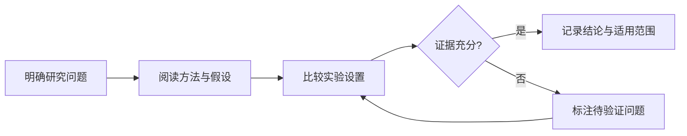

这页是组件维护与体验入口。示例数据只用于展示界面，不代表论文实验结果。中英文混排示例：Agent Memory、LLM post-training 与可复现实验。

## 排版与重点

阅读论文时，先明确问题、方法与结论，再比较假设、实验设置和适用范围。正文使用 LXGW 与 JetBrains，说明文字、代码和标题保持清楚的层次。

**重要判断保留加粗。** <mark>需要特别指出的短语可以单独使用荧光笔。</mark> 行内代码如 `batch_size=8` 应与正文易于区分。

> 评估一种方法时，应同时记录它改善了什么，以及它依赖的条件。
> <cite>— 排版示例引用</cite>

> [!TIP] 阅读顺序
> 先读摘要与结论，再按目录进入方法、实验与局限。

> [!WARNING] 示例数据
> 以下表格只是组件演示，请勿当作真实研究结果引用。

<details>
<summary>展开补充说明</summary>

折叠内容适合补充推导、实现细节和附加实验，关键结论仍应直接显示在正文中。

</details>

## 表格比较

这张表故意包含多列和较长的描述，可以在窄屏横向滑动，或展开查看。数值列保留 Markdown 指定的右对齐。

| 示例方法 | 使用条件 | 准确率（演示） | 耗时（演示） | 说明 |
| --- | --- | ---: | ---: | --- |
| Baseline | 单一任务 | 72.30 | 180 | 用于检查数字对齐 |
| Variant A | 多任务与更长上下文 | 75.45 | 240 | 长名称和说明应正常换行 |
| Variant B | 有限训练预算 | 74.10 | 120 | 表头、边框与悬停状态适配明暗主题 |
| Variant C | 额外验证数据 | 76.80 | 300 | 展开后仍保留完整列关系 |

## 代码与配置

### 带行号的代码

```python title="evaluate.py" showLineNumbers {5-6}
def evaluate(model, dataset):
    results = []
    for example in dataset:
        prediction = model(example["input"])
        score = compare(prediction, example["target"])
        results.append(score)
    return sum(results) / len(results)
```

### 自然语言 Prompt

```text title="阅读提示"
请概括论文的问题、主要假设、方法、实验设置与局限。将作者明确陈述的结论与你根据实验作出的推断分开，并说明哪些条件变化后需要重新验证。
```

### 长代码折叠

超过 24 行的代码默认收起。这里用完整的配置示例检查展开、复制与全屏。

```yaml title="reading-example.yml"
project:
  name: reading-example
  purpose: component-preview

content:
  language: zh-Hans
  collections:
    - agent
    - paper-weekly
  tags: false

reader:
  size: standard
  width: standard
  spacing: relaxed
  focus: false

tables:
  horizontal_scroll: true
  copy_format: tsv

images:
  captions: true
  viewer: photoswipe

diagrams:
  renderer: mermaid
  export: svg
  zoom: panzoom
```

## 方法流程图



## 图片与说明


### 图组

同一段里的多张独立图片组成图组。以下重复使用同一张示意图，仅用于检查查看器的前后切换。


## 数学公式

行内公式 $p(y\mid x)$ 与正文协调显示。行间公式使用本站托管的 KaTeX 样式：

$$
\mathcal{L} = -\frac{1}{N}\sum_{i=1}^{N}\log p(y_i\mid x_i)
$$

## 导航与分享

目录显示当前章节，手机可展开目录切换章节。页面左下角可以切换纯净阅读、字号、正文宽度与行距，右下角返回顶部。

选择这一段中的四个或更多字符，可以测试段落分享。打开生成的链接后，应滚动到对应段落并突出显示。

站内文章预览可以用[Agent 记忆思考](/posts/agent-memory-thoughts)测试。
